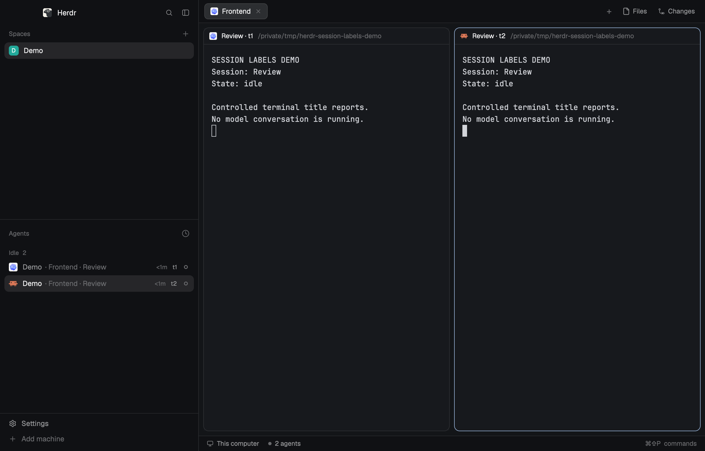
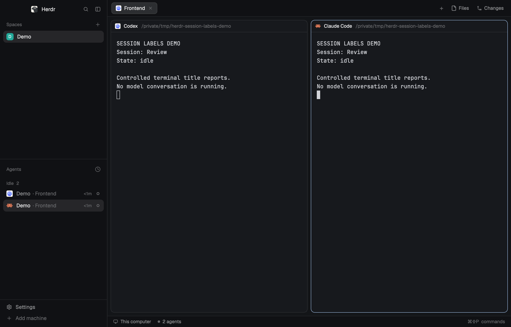

# Herdr Session Labels

Keep **tab context and session names together** in [Herdr Desktop](https://github.com/herdrdev/herdr-app), so two agents named “Review” remain distinguishable.

[](https://github.com/code2m/herdr-session-labels/actions/workflows/tests.yml)
[Version 0.1.0](https://github.com/code2m/herdr-session-labels/releases/tag/v0.1.0) · [Changelog](CHANGELOG.md) · [Validation](VALIDATION.txt)



A layout arranges the Herdr window; mods draw its panels. This layout adds two custom mods for the agent list and pane headers. It preserves tab context, follows session-title changes and adds terminal IDs when names collide. Upstream already supports per-agent titles in shared tabs; keeping the tab context is the additional behavior here.

## Before installing

- **Tested only on Herdr Desktop 0.1.13, macOS.** This is not a legacy Herdr TUI plugin.
- Custom copies of the agent list and pane header do not automatically receive upstream mod updates. Other referenced shipped panels remain Herdr's own. Revisit compatibility when upgrading Herdr.
- No model configuration, hooks or keybindings are installed. The mods make no network calls or automatic subprocess launches.
- OpenClaw needs an existing adapter that reports agent status and `OpenClaw | display name` as the terminal title. An adapter is **not bundled**.

## Install

Download the release archive or clone this repo, then open a terminal in its root. Herdr must already be installed and running. The commands below target the standard macOS/Linux app home, `~/.config/herdr-app`; if you use `HERDR_APP_HOME`, they use that instead. Windows installation has not been validated.

```sh
# Run from the downloaded repository directory, using sh/zsh/bash.
(
set -e
app_home="${HERDR_APP_HOME:-$HOME/.config/herdr-app}"
for item in layouts/session-labels.json mods/session-labels-agents mods/session-labels-pane; do
  if [ -e "$app_home/$item" ]; then
    echo "Already exists: $app_home/$item — stop; do not overwrite."
    exit 1
  fi
done
mkdir -p "$app_home/layouts" "$app_home/mods"
cp layouts/session-labels.json "$app_home/layouts/"
cp -R mods/session-labels-agents mods/session-labels-pane "$app_home/mods/"
herdr-app check "$app_home/mods/session-labels-agents"
herdr-app check "$app_home/mods/session-labels-pane"
)
```

Both checks must pass. Then select **Session Labels** in Herdr's layout picker, or run `herdr-app do layout.switch --name session-labels`. Note your previous layout first so you can switch back.

If names already exist, stop and inspect them. To install under different names, update all of these references together:

1. The layout filename and both `content.mod` entries in its JSON.
2. The custom mod directories and `openOverlay({ mod: ... })` in the agents mod.
3. Every `mods/session-labels-pane/` asset path in the pane mod.

Alternatively, ask your agent to follow [RECIPE.md](RECIPE.md) and your app home's `AGENTS.md`. The recipe is the reconstruction/install brief used by Herdr's layout catalog.

## Disable or remove

Switch to your previous layout first (for example `herdr-app do layout.switch --name main`). This leaves your terminals running. To uninstall this layout, delete only these three installed paths:

- `layouts/session-labels.json`
- `mods/session-labels-agents/`
- `mods/session-labels-pane/`

Use your actual names if you renamed them during installation. Herdr-managed view-state storage and existing terminal pin labels are not reset by deleting these files. Do not remove your app home or shared state.

## What changes

| View | Labels |
| --- | --- |
| Normal sidebar | `Space · Tab · Session`, with a separate terminal ID for duplicates |
| Sidebar 160–239px | Session first; space and tab on a second line; elapsed time hidden |
| Compact rail below 160px | Numbered agents, as in the shipped sidebar |
| Pane header | Session name, plus a terminal ID for matching names within a tab |

Hover for the complete sidebar identity. Automatic tab numbers are retained as useful context. Focus, pinning, status grouping and sub-agent trees retain the cloned behavior. Stored tab names and saved conversations are never renamed.

### Before and after

Same demonstration sessions, using the shipped **0.1.13** sidebar versus this layout. These screenshots are an illustration with controlled title reports, not model conversations or a comparison against current upstream master.

| Shipped 0.1.13 | Session Labels |
| --- | --- |
|  |  |

[Narrow sidebar example](docs/narrow.png)

## Title compatibility

| Program | Recognized format | Evidence |
| --- | --- | --- |
| Codex 0.166.0 | `name \| folder`, optionally prefixed by a braille activity glyph | Actual working title captured; one leading braille glyph removed |
| Codex | Known bracketed status component before `name \| folder` | Synthetic regression cases; not in current captures |
| Claude Code 2.1.319 | `✳ name`, `◐ name`, or plain title | Actual titles captured during a local rename |
| OpenClaw adapter | `OpenClaw \| display name` plus status reports | Protocol fixtures only; adapter not validated here |

Other Claude activity glyphs remain unverified. Unrecognized Codex formats use a program/address fallback. Names beginning with a recognized status glyph and a space are ambiguous and can lose that prefix. Long text still truncates; the tooltip provides the full identity. Other agent types retain the cloned sidebar's label policy.

## Development and validation

Node.js 18 or newer; no npm dependencies:

```sh
npm test
```

Tests render the actual mod code with lightweight element mocks; they do not test native GPUI layout. GitHub Actions runs them on Node 18, 22 and 24. See [VALIDATION.txt](VALIDATION.txt) for native checks, screenshot reproduction and explicit limits. Native sub-agent keyboard navigation, restart persistence, other OSes and later Herdr binaries remain unverified.

Independent community layout; not endorsed by Herdr. Apache-2.0; see [NOTICE](NOTICE) for upstream provenance and [LICENSE](LICENSE) for terms.
