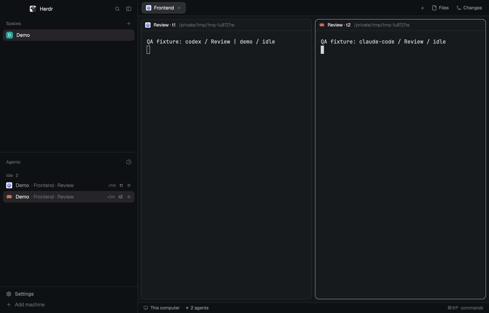

# Herdr Session Labels

Keep tab context alongside Codex, Claude Code and OpenClaw session names in Herdr's agent list, with live per-session pane headers. It is a personal alternative to the shipped labeling policy.

## What you see

A two-column layout based on Herdr's main layout. The left sidebar is initially 268px wide (44–480px bounds), with brand, spaces, agents and footer. The work column has the tab bar, active tab, optional Files/Changes panel and status footer. Pane frames have 30px always-visible headers and 8px gaps. Use theme colors and native text styling.

Agent rows retain the shipped 30px height. In Priority view they show space followed by tab and session. Grouped view puts the space above the rows. Duplicate full labels in a space gain a separate, nonshrinking terminal-address suffix. The full sidebar label is a tooltip. Pane headers show the session without repeating the tab, adding an address when names in that tab match.

## How it behaves

Live Herdr data changes redraw the labels; never poll session databases or call model providers. Working uses the native spinning status icon, blocked shows the attention state, done a filled status dot and idle a ring. Priority/grouped ordering, pinned agents, viewed-done handling and sub-agent trees follow the cloned sidebar. A kept sub-agent appears under its parent rather than twice, except where the rail or pinning needs a separate row.

Click an agent to focus its pane. Hover offers the existing pin control and identity tooltip. The pane header focuses its pane and reveals split, zoom and close controls. The sort menu switches between Priority and Grouped. Below 160px sidebar width, preserve the compact numbered rail. Do not add keybindings.

## Built from

`layouts/session-labels.json` uses `session-labels-agents` for the agents block and `session-labels-pane` for pane headers. Other blocks use the shipped `workspace-chrome`, `spaces`, `tabs`, `files`, `changes` and `workspace-status` mods.

The custom sidebar reads agents, terminals, panes, spaces, focus, layout, theme and shared state. It uses `pane.focus`, terminal pin/peek commands, layout resize and its sort popup. The header reads pane props and uses focus/split/zoom/close commands. The helper module is duplicated in both mod directories because a mod cannot import another mod's files. Keep these copies byte-identical.

Derive supported session names from terminal titles: Codex's final ` | ` component is the working directory; strip an optional status component. Strip the observed leading braille activity glyph from Codex titles and one leading ✳ or ◐ status glyph from Claude titles. Only remove a complete known Codex status component if a session component follows. Preserve names such as [!] Fix login. OpenClaw uses the suffix of `OpenClaw | `. Empty/generic titles fall back to program plus terminal identity. Preserve Unicode and separators inside names. Keep other agents' labels unchanged.

No network access, external file reads, subprocess launch, model calls or agent hooks are needed. Included pane SVGs come from Herdr; other icons refer to shipped mods.

## Watch out

Never overwrite the user's existing layout or mods during installation. Rename incoming names and every reference on collision. Never change stored tab names to imitate session names. The OpenClaw bridge is a separate prerequisite, not bundled here. Future CLI title formats may need updated parsing. At small widths, long names truncate and require the tooltip. The rail intentionally omits labels. Personal clones require maintenance when upstream changes.

## Done when

Both mods pass `herdr-app check`. Different agents in one tab have separate names; a rename updates without restarting; identical session names across tabs retain tab context; identical names in one tab gain addresses; unnamed agents have fallbacks. Status transitions and Unicode titles work. Grouped, pinned and compact views preserve focus behavior. Test these in an isolated app home and core; confirm no mod errors and inspect actual screenshots. Do not claim a native platform test based only on the mocked render tests.
